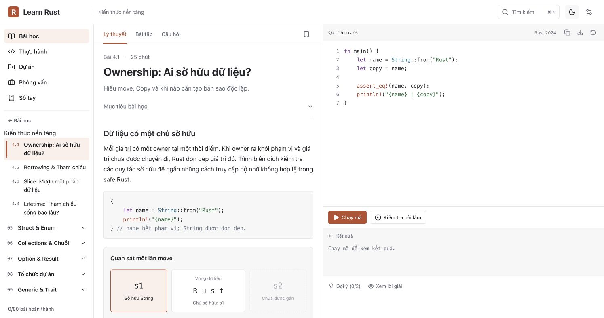

# Sidebar và hiệu năng điều hướng

Đã kiểm tra trên bản production local `iOQPdKY4IKUDQq02ucgt8`, ngày 11/11/2026.

## Thay đổi

- Đưa khung học vào shared layout để giữ menu, chương đang mở, tiến độ và theme khi chuyển bài.
- Chỉ gửi dữ liệu của trang hiện tại trong soft navigation; danh mục nằm trong layout và được đồng bộ bằng phiên bản khi xuất bản thay đổi.
- Tách các phần giao diện tải theo nhu cầu, dựng nội dung Cargo khi mở lần đầu.
- Khi cache Supabase hết TTL, kiểm tra revision và release ID trước khi tải lại catalog; giữ kiểm tra lỗi và snapshot nhất quán.
- Đợi overlay đóng trước khi focus nội dung sau Back/Forward. Đóng modal thông thường trả focus về nút mở.
- Chỉ đưa bài vào vùng nhìn khi đổi khóa hoặc mở URL trực tiếp; giữ vị trí cuộn khi chuyển bài trong cùng khóa.

## Bằng chứng

- [So sánh hiệu năng](comparison-notes.md): 6 route, HTML và RSC, 3 warm-up + 8 mẫu mỗi ca.
- [UI regression](ui-regression.json): thao tác Chrome thật, mở 3 chương và giữ scroll 489,5 → 489,5 px; Back từ Settings, đóng modal bình thường, tìm kiếm sang khóa khác, theme và bài trước/sau.
- [Kiểm tra mã và dữ liệu](staticchecks-after.json): lint, 45 content/progress tests, diff check.
- [SEO](seo-after.json): 388 trang, SSR, metadata, redirect, 404 và ảnh chia sẻ.
- [Supabase revalidation](revalidation-notes.md): phản hồi metadata 68 byte khi publication không đổi.

RSC giảm 72,70–95,93% byte thô ở các route đã đo. JavaScript ban đầu giảm 31,84–37,66%. Số đo là HTTP loopback và kích thước dữ liệu; không phải INP/LCP hay thời gian vẽ giao diện. Báo cáo giữ cả các trường hợp HTML hoặc TTFB tăng nhẹ.

